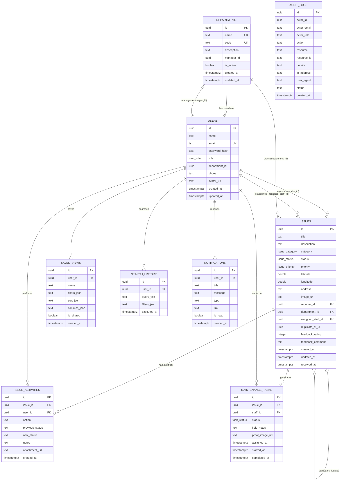

# CivicPulse — Database Design Document

**Project:** CivicPulse — Smart City Infrastructure Management Platform
**Database:** PostgreSQL (Neon Cloud / local PostgreSQL 14+)
**ORM:** Drizzle ORM (`drizzle-orm` + `drizzle-kit`)
**Schema source of truth:** [`backend/src/db/schema.ts`](../backend/src/db/schema.ts)
**Version:** 1.0.0

---

## Table of Contents

1. [Overview & Design Goals](#1-overview--design-goals)
2. [Technology & Connection Layer](#2-technology--connection-layer)
3. [Entity–Relationship Diagram](#3-entityrelationship-diagram)
4. [Enum Types](#4-enum-types)
5. [Data Dictionary](#5-data-dictionary)
6. [Relationships & Referential Integrity](#6-relationships--referential-integrity)
7. [Indexes & Query Performance](#7-indexes--query-performance)
8. [Issue Lifecycle State Machine](#8-issue-lifecycle-state-machine)
9. [Audit & Immutability Strategy](#9-audit--immutability-strategy)
10. [Normalization & Design Decisions](#10-normalization--design-decisions)
11. [Seed Data](#11-seed-data)
12. [Common Query Patterns](#12-common-query-patterns)
13. [Migration & Maintenance Workflow](#13-migration--maintenance-workflow)

---

## 1. Overview & Design Goals

CivicPulse models the complete municipal issue-resolution workflow: a citizen reports an
infrastructure problem, the report is routed to a department, a manager triages and assigns it
to a field technician, the technician performs the repair and uploads proof, and the citizen
confirms the outcome with a rating. Every action along the way is recorded for auditability.

The schema was designed around the following goals:

| Goal | How the schema achieves it |
|---|---|
| **Traceable lifecycle** | `issues.status` drives a strict state machine; every transition is appended to `issue_activities`. |
| **Role-scoped access** | `users.role` + `users.department_id` allow server-side RBAC and department-scoped queries. |
| **Geospatial duplicate detection** | `issues.latitude` / `longitude` plus the `idx_issues_coords` index support 50 m Haversine proximity checks. |
| **Fast dashboard queries** | Composite B-tree indexes cover the highest-frequency filters (department + status, reporter + date, category + priority). |
| **Tamper-evident governance** | `issue_activities` and `audit_logs` are append-only; no update or delete endpoints exist for them. |
| **Referential safety** | Explicit `REFERENCES` with `ON DELETE CASCADE` on child history/task tables. |
| **Data integrity** | PostgreSQL native `ENUM` types, `NOT NULL` constraints, `UNIQUE` keys, and Zod validation at the API boundary. |

---

## 2. Technology & Connection Layer

### 2.1 Stack

- **Database engine:** PostgreSQL (hosted on Neon Cloud, compatible with any standard PostgreSQL 14+ instance).
- **ORM:** Drizzle ORM with the `postgres-js` driver.
- **Schema definition:** TypeScript-first, defined in `backend/src/db/schema.ts`.
- **Migrations:** `drizzle-kit` (`npm run db:generate`, `npm run db:push`).
- **Seeding:** `npm run db:seed` runs `backend/src/db/seed.ts` with stable, realistic demo data.

### 2.2 Connection configuration

`backend/src/db/index.ts`:

```ts
const client = postgres(connectionString, {
  max: 10,               // connection pool size
  idle_timeout: 60,      // seconds
  connect_timeout: 10,   // seconds
  prepare: false,        // required for serverless / Neon pooling
  ssl: connectionString.includes('neon.tech') ? 'require' : false,
});

export const db = drizzle(client, { schema });
```

- The connection string is read from `DATABASE_URL`.
- SSL is automatically enabled for Neon hosts.
- `prepare: false` keeps the client compatible with transaction-pooling proxies and serverless runtimes.

---

## 3. Entity–Relationship Diagram



> **Legend:** PK = primary key, FK = foreign key, UK = unique key.
> `users.department_id`, `departments.manager_id`, and `issues.duplicate_of_id` are logical
> links without DDL constraints; the `ISSUES` self-reference models duplicate reports.

---

## 4. Enum Types

PostgreSQL native enums are generated by Drizzle via `pgEnum`.

### 4.1 `user_role`

| Value | Description |
|---|---|
| `admin` | City administrator — full governance, user/department management, global analytics. |
| `department_manager` | Manages one department: triage, verify, assign, close issues. |
| `maintenance_staff` | Field technician: updates only tasks assigned to them. |
| `citizen` | Public reporter: creates reports, tracks them, submits feedback. |

### 4.2 `issue_category`

| Value | Routed department code |
|---|---|
| `road_damage` | `DEPT-ROAD` |
| `streetlight` | `DEPT-ELEC` |
| `drainage` | `DEPT-WATER` |
| `footpath` | `DEPT-INFRA` |
| `waste_management` | `DEPT-WASTE` |
| `public_infrastructure` | `DEPT-INFRA` |

### 4.3 `issue_status`

`submitted`, `under_review`, `assigned`, `in_progress`, `resolved`, `closed`

### 4.4 `issue_priority`

`low`, `medium`, `high`, `critical`

### 4.5 `task_status`

`pending`, `in_progress`, `completed`

---

## 5. Data Dictionary

### 5.1 `users`

Stores every platform identity — citizens, field staff, managers, and administrators.

| Column | Type | Constraints / Default | Description |
|---|---|---|---|
| `id` | `UUID` | PK, `DEFAULT gen_random_uuid()` | Surrogate primary key. |
| `name` | `TEXT` | `NOT NULL` | Display name. |
| `email` | `TEXT` | `NOT NULL`, `UNIQUE` | Login identifier (normalized lowercase by the API). |
| `password_hash` | `TEXT` | `NOT NULL` | bcrypt hash (cost 10). |
| `role` | `user_role` | `NOT NULL`, `DEFAULT 'citizen'` | Authorization role. |
| `department_id` | `UUID` | nullable | Department membership; logical FK → `departments.id`. |
| `phone` | `TEXT` | nullable | Contact number. |
| `avatar_url` | `TEXT` | nullable | Profile image URL. |
| `created_at` | `TIMESTAMPTZ` | `NOT NULL`, `DEFAULT now()` | Creation timestamp. |
| `updated_at` | `TIMESTAMPTZ` | `NOT NULL`, `DEFAULT now()` | Last update timestamp. |

**Notes**
- Self-registration always creates `citizen` accounts; elevated roles are provisioned by an admin.
- `department_id` is declared as a plain UUID column (no DB-level `REFERENCES`). Together with
  `departments.manager_id`, keeping both sides logical avoids a circular DDL dependency and lets
  departments and managers be provisioned in any order. Referential consistency is enforced in
  the service layer.

---

### 5.2 `departments`

Municipal operating units responsible for issue categories.

| Column | Type | Constraints / Default | Description |
|---|---|---|---|
| `id` | `UUID` | PK, `DEFAULT gen_random_uuid()` | Surrogate primary key. |
| `name` | `TEXT` | `NOT NULL`, `UNIQUE` | Department name. |
| `code` | `TEXT` | `NOT NULL`, `UNIQUE` | Stable short code used for category routing (e.g. `DEPT-ROAD`). |
| `description` | `TEXT` | nullable | Responsibility summary. |
| `manager_id` | `UUID` | nullable | Logical FK → `users.id` (the manager). |
| `is_active` | `BOOLEAN` | `NOT NULL`, `DEFAULT true` | Soft lifecycle flag. |
| `created_at` | `TIMESTAMPTZ` | `NOT NULL`, `DEFAULT now()` | Creation timestamp. |
| `updated_at` | `TIMESTAMPTZ` | `NOT NULL`, `DEFAULT now()` | Last update timestamp. |

**Seeded departments:** `DEPT-ROAD`, `DEPT-ELEC`, `DEPT-WATER`, `DEPT-WASTE`, `DEPT-INFRA`.

---

### 5.3 `issues`

Central fact table — one row per citizen report.

| Column | Type | Constraints / Default | Description |
|---|---|---|---|
| `id` | `UUID` | PK, `DEFAULT gen_random_uuid()` | Surrogate primary key. |
| `title` | `TEXT` | `NOT NULL` | Short summary (API validates 5–200 chars). |
| `description` | `TEXT` | `NOT NULL` | Detailed description (API validates ≥ 10 chars). |
| `category` | `issue_category` | `NOT NULL` | Issue type; drives department routing. |
| `status` | `issue_status` | `NOT NULL`, `DEFAULT 'submitted'` | Lifecycle state. |
| `priority` | `issue_priority` | `NOT NULL`, `DEFAULT 'medium'` | Triage priority. |
| `latitude` | `DOUBLE PRECISION` | `NOT NULL` | GPS latitude (−90…90). |
| `longitude` | `DOUBLE PRECISION` | `NOT NULL` | GPS longitude (−180…180). |
| `address` | `TEXT` | `NOT NULL` | Human-readable location. |
| `image_url` | `TEXT` | nullable | Photo URL or base64 data URI (≤ 8 MB). |
| `reporter_id` | `UUID` | `NOT NULL`, FK → `users.id` | Citizen who filed the report. |
| `department_id` | `UUID` | nullable, FK → `departments.id` | Routed department. |
| `assigned_staff_id` | `UUID` | nullable, FK → `users.id` | Field technician currently assigned. |
| `duplicate_of_id` | `UUID` | nullable | Logical self-FK to the original report. |
| `feedback_rating` | `INTEGER` | nullable | 1–5 star citizen rating. |
| `feedback_comment` | `TEXT` | nullable | Optional citizen comment. |
| `created_at` | `TIMESTAMPTZ` | `NOT NULL`, `DEFAULT now()` | Submission time. |
| `updated_at` | `TIMESTAMPTZ` | `NOT NULL`, `DEFAULT now()` | Last modification time. |
| `resolved_at` | `TIMESTAMPTZ` | nullable | Time the issue reached `resolved` (used for SLA metrics). |

**Derived value:** the tracking code `CP-XXXXXXXX` is computed as the first 8 hex characters of
`id` uppercased — it is not stored separately.

---

### 5.4 `issue_activities`

Append-only audit trail for every issue event (submission, status change, assignment, feedback,
community upvote, cancellation).

| Column | Type | Constraints / Default | Description |
|---|---|---|---|
| `id` | `UUID` | PK, `DEFAULT gen_random_uuid()` | Surrogate primary key. |
| `issue_id` | `UUID` | `NOT NULL`, FK → `issues.id` `ON DELETE CASCADE` | Parent issue. |
| `user_id` | `UUID` | `NOT NULL`, FK → `users.id` | Actor who performed the action. |
| `action` | `TEXT` | `NOT NULL` | Event code, e.g. `SUBMITTED`, `STATUS_CHANGE_TO_ASSIGNED`, `COMMUNITY_UPVOTE`. |
| `previous_status` | `TEXT` | nullable | Status before the event. |
| `new_status` | `TEXT` | nullable | Status after the event. |
| `notes` | `TEXT` | nullable | Human-readable explanation. |
| `attachment_url` | `TEXT` | nullable | Proof photo or supporting file. |
| `created_at` | `TIMESTAMPTZ` | `NOT NULL`, `DEFAULT now()` | Event time. |

**Immutability:** the API never exposes update/delete operations for this table. Rows are only
inserted via `logIssueActivity()`.

---

### 5.5 `maintenance_tasks`

Work orders that connect an issue to a field technician.

| Column | Type | Constraints / Default | Description |
|---|---|---|---|
| `id` | `UUID` | PK, `DEFAULT gen_random_uuid()` | Surrogate primary key. |
| `issue_id` | `UUID` | `NOT NULL`, FK → `issues.id` `ON DELETE CASCADE` | Related issue. |
| `staff_id` | `UUID` | `NOT NULL`, FK → `users.id` | Assigned technician. |
| `status` | `task_status` | `NOT NULL`, `DEFAULT 'pending'` | Work-order state. |
| `field_notes` | `TEXT` | nullable | Technician notes from the field. |
| `proof_image_url` | `TEXT` | nullable | Completion photograph URL / data URI. |
| `assigned_at` | `TIMESTAMPTZ` | `NOT NULL`, `DEFAULT now()` | Dispatch time. |
| `started_at` | `TIMESTAMPTZ` | nullable | Work start time. |
| `completed_at` | `TIMESTAMPTZ` | nullable | Work completion time. |

**Side effects (service layer):**
- Setting a task to `in_progress` also moves the parent issue to `in_progress` (if not already started).
- Setting a task to `completed` also moves the parent issue to `resolved` and stamps `resolved_at`.

---

### 5.6 `saved_views`

Per-user saved data-explorer configurations (filters, sorting, visible columns).

| Column | Type | Constraints / Default | Description |
|---|---|---|---|
| `id` | `UUID` | PK, `DEFAULT gen_random_uuid()` | Surrogate primary key. |
| `user_id` | `UUID` | `NOT NULL`, FK → `users.id` `ON DELETE CASCADE` | Owner. |
| `name` | `TEXT` | `NOT NULL` | View label. |
| `filters_json` | `TEXT` | `NOT NULL` | Serialized filter object. |
| `sort_json` | `TEXT` | nullable | Serialized sort configuration. |
| `columns_json` | `TEXT` | nullable | Serialized visible-column list. |
| `is_shared` | `BOOLEAN` | `NOT NULL`, `DEFAULT false` | Whether other users may use the view. |
| `created_at` | `TIMESTAMPTZ` | `NOT NULL`, `DEFAULT now()` | Creation time. |

JSON is stored as `TEXT` because the payloads are opaque to the database and only ever read
back by the owning client.

---

### 5.7 `search_history`

Recent search queries per user.

| Column | Type | Constraints / Default | Description |
|---|---|---|---|
| `id` | `UUID` | PK, `DEFAULT gen_random_uuid()` | Surrogate primary key. |
| `user_id` | `UUID` | `NOT NULL`, FK → `users.id` `ON DELETE CASCADE` | Owner. |
| `query_text` | `TEXT` | `NOT NULL` | Search string. |
| `filters_json` | `TEXT` | nullable | Serialized filters active at search time. |
| `executed_at` | `TIMESTAMPTZ` | `NOT NULL`, `DEFAULT now()` | Execution time. |

---

### 5.8 `notifications`

In-app notifications delivered to a specific user.

| Column | Type | Constraints / Default | Description |
|---|---|---|---|
| `id` | `UUID` | PK, `DEFAULT gen_random_uuid()` | Surrogate primary key. |
| `user_id` | `UUID` | `NOT NULL`, FK → `users.id` `ON DELETE CASCADE` | Recipient. |
| `title` | `TEXT` | `NOT NULL` | Notification headline. |
| `message` | `TEXT` | `NOT NULL` | Body text. |
| `type` | `TEXT` | `NOT NULL` | UI variant: `info`, `success`, `warning`, `error`. |
| `link` | `TEXT` | nullable | Deep link into the app. |
| `is_read` | `BOOLEAN` | `NOT NULL`, `DEFAULT false` | Read flag. |
| `created_at` | `TIMESTAMPTZ` | `NOT NULL`, `DEFAULT now()` | Creation time. |

**Hybrid feed:** the notifications endpoint merges persisted rows with recent role-scoped
`issue_activities` (mapped into notification shape on the fly), so users see live events even
before a dedicated notification row is written.

---

### 5.9 `audit_logs`

System-wide security and administrative audit trail (separate from per-issue history).

| Column | Type | Constraints / Default | Description |
|---|---|---|---|
| `id` | `UUID` | PK, `DEFAULT gen_random_uuid()` | Surrogate primary key. |
| `actor_id` | `UUID` | nullable | Acting user (nullable for anonymous events). |
| `actor_email` | `TEXT` | nullable | Actor email snapshot. |
| `actor_role` | `TEXT` | nullable | Actor role snapshot. |
| `action` | `TEXT` | `NOT NULL` | Event code, e.g. `USER_CREATED`, `PASSWORD_RESET_COMPLETED`. |
| `resource` | `TEXT` | `NOT NULL` | Affected resource type, e.g. `users`, `departments`, `settings`. |
| `resource_id` | `TEXT` | nullable | Affected resource identifier. |
| `details` | `TEXT` | nullable | Serialized JSON details. |
| `ip_address` | `TEXT` | nullable | Request IP (`x-forwarded-for` aware). |
| `user_agent` | `TEXT` | nullable | Truncated User-Agent (≤ 500 chars). |
| `status` | `TEXT` | `NOT NULL`, `DEFAULT 'SUCCESS'` | `SUCCESS`, `DENIED`, or `FAILED`. |
| `created_at` | `TIMESTAMPTZ` | `NOT NULL`, `DEFAULT now()` | Event time. |

Actor data is **denormalized on purpose** so the log remains meaningful even if the user record
is later modified or deleted.

---

## 6. Relationships & Referential Integrity

| Parent | Child | Column | Cardinality | On delete |
|---|---|---|---|---|
| `users` | `issues` (reporter) | `reporter_id` | 1 : N | Restrict (no action) |
| `users` | `issues` (assignee) | `assigned_staff_id` | 1 : N | No action (service-level handling) |
| `departments` | `issues` | `department_id` | 1 : N | No action |
| `issues` | `issue_activities` | `issue_id` | 1 : N | **CASCADE** |
| `users` | `issue_activities` | `user_id` | 1 : N | No action |
| `issues` | `maintenance_tasks` | `issue_id` | 1 : N | **CASCADE** |
| `users` | `maintenance_tasks` | `staff_id` | 1 : N | No action |
| `users` | `saved_views` | `user_id` | 1 : N | **CASCADE** |
| `users` | `search_history` | `user_id` | 1 : N | **CASCADE** |
| `users` | `notifications` | `user_id` | 1 : N | **CASCADE** |
| `users` | `departments` (manager) | `manager_id` | 1 : 0..1 (logical) | No action |
| `departments` | `users` (membership) | `department_id` | 1 : N (logical) | No action |
| `issues` | `issues` (duplicate) | `duplicate_of_id` | 1 : N (logical) | No action |

### Why some links are logical rather than enforced FKs

- `departments.manager_id` → `users.id` and `users.department_id` → `departments.id` form a
  **circular dependency**. Enforcing both at DDL time complicates seed order and department
  creation. The API/service layer validates both sides instead.
- `issues.duplicate_of_id` references `issues.id`. A DB-level self-FK is possible, but keeping it
  logical lets the duplicate radar link a report even if the original is later cancelled
  (`closed`) without cascading side effects.
- All *history-bearing* children (`issue_activities`, `maintenance_tasks`) and *user-owned*
  tables use explicit FKs with `CASCADE`, because orphaned rows there would be data corruption.

---

## 7. Indexes & Query Performance

| Index | Table | Columns | Purpose |
|---|---|---|---|
| `idx_issues_dept_status` | `issues` | `(department_id, status)` | Department dashboards and queue counts. |
| `idx_issues_reporter` | `issues` | `(reporter_id, created_at)` | "My reports" feed ordered by newest. |
| `idx_issues_category_priority` | `issues` | `(category, priority)` | Explorer filters and duplicate radar candidate scan. |
| `idx_issues_coords` | `issues` | `(latitude, longitude)` | Bounding-box prefilter for the 50 m Haversine duplicate check. |
| `idx_issue_activities_issue` | `issue_activities` | `(issue_id, created_at)` | Chronological audit trail per issue. |
| `idx_maintenance_tasks_staff` | `maintenance_tasks` | `(staff_id, status)` | Field technician work board. |
| `idx_audit_logs_actor` | `audit_logs` | `(actor_id, created_at)` | Per-actor security investigations. |
| `idx_audit_logs_action` | `audit_logs` | `(action, created_at)` | Event-type reporting. |
| `idx_audit_logs_resource` | `audit_logs` | `(resource, created_at)` | Resource history drill-down. |

**Additional implicit indexes**
- Primary keys on every table.
- Unique constraints on `users.email`, `departments.name`, and `departments.code`.

**Why composite indexes are ordered this way**
- Equality columns come first (`department_id`, `reporter_id`, `staff_id`, `issue_id`) followed
  by the second equality filter or sort column (`status`, `created_at`, `priority`). This matches
  how the API queries the data (`WHERE x = ? AND y = ?` or `WHERE x = ? ORDER BY created_at DESC`).
- `idx_issues_coords` is a coarse prefilter. The exact 50 m radius is computed in the
  application with the Haversine formula (`backend/src/lib/geo.ts`), which avoids requiring the
  PostGIS extension while remaining accurate for city-scale distances.

---

## 8. Issue Lifecycle State Machine

```text
Happy path
──────────
submitted ──verify──► under_review ──assign──► assigned ──start work──► in_progress
    ──repair complete──► resolved ──feedback / close──► closed

Side transitions
────────────────
• submitted     → closed        (citizen cancels, or manager/admin closes)
• under_review  → closed        (manager/admin closes)
• assigned      → under_review  (manager returns the issue to triage / reassigns)
• in_progress   → assigned      (reassignment)
• resolved      → in_progress   (rework required)
• closed        → under_review  (manager/admin reopens)
```

### Allowed transitions (enforced in `backend/src/lib/validation.ts`)

| From | To |
|---|---|
| `submitted` | `under_review`, `closed` |
| `under_review` | `assigned`, `closed` |
| `assigned` | `in_progress`, `under_review` |
| `in_progress` | `resolved`, `assigned` |
| `resolved` | `closed`, `in_progress` |
| `closed` | `under_review` |

### Role authority over transitions

| Actor | Allowed moves |
|---|---|
| `citizen` | No direct status changes. Can submit feedback, which sets the issue to `closed`. Can cancel their own report **before triage** (sets `closed`). |
| `maintenance_staff` | Only issues assigned to them; only `in_progress` and `resolved`. |
| `department_manager` | Own department only: `under_review`, `assigned`, `in_progress`, `resolved`, `closed`, reopen to `under_review`. |
| `admin` | Any valid transition on any issue. |

Invalid transitions return **HTTP 400**; unauthorized transitions return **HTTP 403**.

---

## 9. Audit & Immutability Strategy

CivicPulse separates **business history** from **security history**:

| Concern | Table | Written by | Mutability |
|---|---|---|---|
| Per-issue lifecycle | `issue_activities` | `logIssueActivity()` | Append-only |
| Platform administration | `audit_logs` | `logSecurityAudit()` | Append-only |

### 9.1 `issue_activities` event codes

| Action | Trigger |
|---|---|
| `SUBMITTED` | Citizen creates a report. |
| `SUBMITTED_WITH_AUTO_DUPLICATE_LINK` | Report linked to a nearby existing issue (≤ 50 m). |
| `STATUS_CHANGE_TO_<STATUS>` | Any validated status transition. |
| `ISSUE_DETAILS_UPDATED` | Citizen/manager edits issue details. |
| `REPORT_CANCELLED_BY_REPORTER` | Citizen cancels before triage. |
| `FEEDBACK_SUBMITTED_AND_CLOSED` | Citizen submits a rating; issue closes. |
| `COMMUNITY_UPVOTE` | Another citizen confirms the issue. |
| `UPDATED` | Non-status administrative update. |

### 9.2 `audit_logs` event codes

| Action | Trigger |
|---|---|
| `USER_SELF_REGISTERED` | Public registration. |
| `USER_CREATED` / `USER_DELETED` | Admin user management. |
| `USER_ROLE_OR_DEPT_MODIFIED` | Admin changes role or department. |
| `DEPARTMENT_CREATED` / `DEPARTMENT_MODIFIED` | Admin department management. |
| `SYSTEM_SETTINGS_UPDATED` | Admin changes global configuration. |
| `PASSWORD_RESET_REQUESTED` / `PASSWORD_RESET_COMPLETED` | Password recovery flow. |

Audit writes are wrapped in `try/catch` and **never block** the primary request; a logging
failure is reported to the server console but does not fail the user action.

---

## 10. Normalization & Design Decisions

### 10.1 Normal form

The core schema is in **Third Normal Form (3NF)**:

- Every table has a single-column surrogate primary key.
- Non-key attributes depend on the whole key (all keys are single-column, so 2NF is satisfied).
- No transitive dependencies: department names live only in `departments`; user names live only
  in `users`; issue status lives only in `issues`.

Deliberate **denormalization** exists only where auditability or read performance justifies it:

- `audit_logs.actor_email` / `actor_role` are snapshots, so history survives user edits/deletion.
- `issue_activities.previous_status` / `new_status` are snapshots, so the trail is self-contained.
- API list responses join `departments.name` and `users.name` at read time rather than storing
  copies in `issues`.

### 10.2 UUID primary keys

- Generated with `gen_random_uuid()`.
- Safe to expose in URLs and tracking codes (`CP-XXXXXXXX`).
- Avoid sequential-ID enumeration and simplify future sharding/merging.

### 10.3 `TIMESTAMPTZ` everywhere

All timestamps are timezone-aware and default to `now()`. This keeps SLA math correct across
server regions and daylight-saving changes.

### 10.4 JSON stored as `TEXT`

`saved_views`, `search_history`, and `audit_logs.details` store serialized JSON in `TEXT`
columns. The database never queries inside these payloads, and `TEXT` avoids driver-specific
JSON serialization differences between local PostgreSQL and Neon's serverless proxy.

### 10.5 Soft lifecycle over hard deletes

- Departments can be deactivated (`departments.is_active`) instead of deleted.
- Issues are never deleted; cancellation sets `status = 'closed'` and appends an activity.
- Users are hard-deleted only by an administrator, and self-deletion is blocked.

### 10.6 Coordinates as `DOUBLE PRECISION`

`DOUBLE PRECISION` provides ~15 significant digits — more than enough for metre-level GPS
accuracy — without requiring PostGIS. If the platform later adds polygon geofencing or routing,
the columns can be migrated to `GEOGRAPHY(POINT, 4326)`.

---

## 11. Seed Data

`npm run db:seed` populates the database with stable, realistic demo data:

| Entity | Count | Details |
|---|---|---|
| Departments | 5 | Roads, Electrical, Water/Sewage, Waste, Public Infrastructure. |
| Users | 33 | 1 admin, 5 department managers, 21 field technicians, 6 citizens (including the demo citizen persona). |
| Issues | 108 | 6 categories × 18 reports, spread across 32 Dhaka locations, all statuses and priorities. |
| Issue activities | 200+ | Submission, review, assignment, resolution events per issue. |
| Maintenance tasks | 70+ | Work orders for assigned/resolved issues. |

Seeding uses `onConflictDoNothing()` and chunked inserts (30 issues / 50 activity and task rows
per batch) so it is idempotent and stays within PostgreSQL parameter limits.

### Demo personas

| Role | Email | Password |
|---|---|---|
| City Administrator | `admin@civicpulse.gov` | `admin123` |
| Department Manager (Roads) | `manager.roads@civicpulse.gov` | `manager123` |
| Field Technician (Electrical) | `staff.electric@civicpulse.gov` | `staff123` |
| Citizen | `citizen.jane@civicpulse.gov` | `citizen123` |

---

## 12. Common Query Patterns

### 12.1 Paginated, filtered issue explorer

```ts
db.select({ ... })
  .from(issues)
  .leftJoin(departments, eq(issues.departmentId, departments.id))
  .leftJoin(users, eq(issues.reporterId, users.id))
  .where(and(...conditions))
  .orderBy(desc(issues.createdAt))
  .limit(limit)
  .offset((page - 1) * limit);
```

Count and page queries execute in parallel with `Promise.all`.

### 12.2 Duplicate radar (50 m)

1. Fetch candidate issues of the same category (index: `idx_issues_category_priority`).
2. Exclude `closed` issues.
3. Compute Haversine distance in application code (`calculateDistanceMeters`).
4. Return the first candidate within the radius.

### 12.3 SLA compliance

For each resolved/closed issue that has a `resolved_at` timestamp:
`hoursTaken = (resolved_at − created_at) / 3,600,000`.

Targets (`analytics-service.ts`):

| Priority | Target |
|---|---|
| `critical` | 24 h |
| `high` | 48 h |
| `medium` | 96 h |
| `low` | 168 h |

Compliance rate = issues meeting target ÷ resolved issues × 100.

### 12.4 Department-scoped notifications

Role filter applied to the activity feed:

- `citizen` → `issues.reporter_id = user.id`
- `maintenance_staff` → `issues.assigned_staff_id = user.id`
- `department_manager` → `issues.department_id = user.department_id`
- `admin` → all issues

---

## 13. Migration & Maintenance Workflow

```bash
# 1. Edit the schema
#    backend/src/db/schema.ts

# 2. Generate a SQL migration
npm run db:generate

# 3. Apply directly to the database (development)
npm run db:push

# 4. Seed demo data
npm run db:seed
```

### Production checklist

- [ ] Set `DATABASE_URL` to the production Neon connection string.
- [ ] Run `db:push` (or apply generated migrations) before deploying the API.
- [ ] Verify SSL is active (`sslmode=require`).
- [ ] Confirm `prepare: false` remains set for pooled/serverless connections.
- [ ] Back up the database before destructive schema changes.
- [ ] Never expose `DATABASE_URL` to the frontend; only the backend uses it.

---

**Related documents**

- [API Documentation](./API_DOCUMENTATION.md)
- [Project README](../README.md)
- [Design specification](./superpowers/specs/2026-11-21-civicpulse-design.md)
